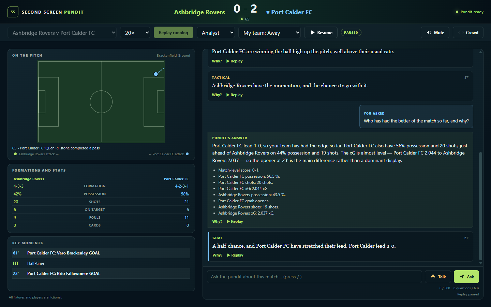

# Second Screen Pundit

**A spoken AI pundit for your second screen. It watches the match with you, says why a moment matters, answers your questions without spoiling what you haven't seen yet, and can show the facts behind every number it says.**

**Try it:** https://ca-pundit-bcd5v7aw3xhmg.salmonbeach-9f471d5c.uksouth.azurecontainerapps.io/

All clubs, players, stadiums and matches are fictional and generated by the app.



## Try it in two minutes

1. Open the link on a phone or a desktop. Wait for **Pundit ready**.
2. Pick **Port Calder FC v Merehaven Athletic** (a red card and a comeback) at **20×**.
3. Choose a **mode** and **My team**, then press **Start replay** and allow audio.
   - **Casual**: the story, not the spreadsheet. At most one number per line, short plain answers, and the stats behind a tap.
   - **Analyst**: chance quality, shape and numbers. Longer answers, the stats shown, and the evidence open under **Why?**
   - **My team**: lines and answers call that side "your side", a ♥ marks it on the scoreboard, its lines get a team-colour edge, and the crowd roars louder for its goals. Change either setting during the match; the next line follows it.
4. Press **Why?** on any line to see the facts and events behind it.
5. Type a question, such as *What changed for Port Calder after the red card?*, or hold **Talk** and ask it.
6. Wait for full time for the recap, written and spoken.

The match pauses when you switch tabs or lock your phone and offers to resume when you come back. The 10-second delay before each event is deliberate: it's the broadcast delay that keeps the pundit from getting ahead of you.

## What it does, and why

Live match data is full of numbers that a casual fan doesn't need and an analyst doesn't trust. Second Screen Pundit turns a stream of match events into short spoken commentary that explains why a moment matters. It answers "why" questions in plain English and recaps the match at full time. Two rules hold throughout:

- **Every number is checked.** Statistics come from deterministic code. The model only chooses and explains them, and a check rejects any line that states something the facts don't support.
- **Nothing gets ahead of the viewer.** Lines, answers and the recap only use what the viewer has already seen.

Architecture, the diagram and how it maps to the five challenge stages (Ingest, Interpret, Explain, Render, Personalize): [docs/ARCHITECTURE.md](docs/ARCHITECTURE.md). Results from the gates: [docs/EVALUATION.md](docs/EVALUATION.md).

## Microsoft technology used

| Technology | What it does here |
| :-- | :-- |
| **Microsoft Foundry** | One `gpt-5.4-mini` deployment (Data Zone Standard, Australia East) serves all five agents |
| **Microsoft Agent Framework** | `FoundryChatClient` agents with structured output; a `WorkflowBuilder` graph routes each live window to the fast path or the tactical path; function middleware captures every tool result for the evidence check |
| **Azure AI Speech** | Commentary, answers and the recap spoken by the MAI voice `en-GB-Harry:MAI-Voice-2.1-Flash` with a style per moment, `en-GB-RyanNeural` as fallback, and server-side speech-to-text for push-to-talk |
| **Azure Container Apps** | One container, one replica: the API, the event stream, the audio and the web page. The image is built remotely in **Azure Container Registry** |
| **Managed identity** | One user-assigned identity for every Azure call: no keys anywhere |
| **Application Insights** | OpenTelemetry traces: Agent Framework's `invoke_agent`, `chat` and `execute_tool` spans with token counts, plus a `pundit.turn` span per window, question and recap |
| **azd and Bicep** | `azd up` provisions and deploys everything |
| **GitHub** | GitHub Copilot Agent Mode built the app phase by phase from [prompts/build-prompt-v2.md](prompts/build-prompt-v2.md) under [.github/copilot-instructions.md](.github/copilot-instructions.md); GitHub Actions runs the tests on every push |

**How AI assistants were used.** Built with GitHub Copilot Agent Mode (GPT-6 Luna), which built the initial phases and polish work, and Claude Code (Opus), which did architecture reviews and the later phases. All the code was directed, reviewed and tested by me.

## How grounding works

- **Facts come from code.** Analytics functions compute possession, shots, xG, pressing, turnovers and formations from the event log. Each result is a fact with an ID, the team and a minute window. Models call these tools; they never compute a statistic.
- **The evidence check.** Every number, score, formation and minute in a line, answer or recap must match a fact from that run's tool results, with the team and metric named in the same sentence. Every cited event must be one the run was allowed to see. A failure is retried once with the reason as feedback, then replaced by a deterministic line built from the same facts.
- **The comparison check.** Casual mode says things in words, so words are checked too. "More of the ball", "more shots", "the better of the chances", "on top" and "under pressure" are tied to the nearest team before them ("your side" means My team). They're then checked against possession, shots and xG for the match so far or the current spell.
- **Citations.** Every line, answer and recap carries the fact and event IDs it relies on. **Why?** shows them: the facts in plain words and the events on a timeline. An answer cites only the facts it used.
- **The viewer cut-off.** The agents see each event as it happens; the viewer sees it 10 seconds later. A line waits for its event to reach the viewer, and a question is answered as of the last event the viewer has seen, so a typed question can never reveal a goal that's still in the delay.
- **Wording checks.** Banned phrases (hype, betting, invented crowd or injury detail), scoring-team phrases on goal lines, a real-name filter, and the Casual and Analyst rules.

## The agents

| Agent | Job | Hands on to |
| :-- | :-- | :-- |
| **Director** | Every 3 match minutes, decides whether the tactical signals are worth a line | the Analyst, or nobody |
| **Analyst** | Calls read-only analytics tools and writes an insight that cites fact IDs | the Commentator |
| **Commentator** | Turns an insight (or a goal, card, substitution or formation change on the fast path) into one spoken line in the viewer's mode | the checks, then speech |
| **Explainer** | Answers viewer questions from a snapshot taken at the viewer's position, in the viewer's mode, framed for My team | the checks, then speech |
| **Recap Producer** | Writes the full-time headline, summary and key moments | the checks, then speech |

**Handoffs** are structured outputs (Pydantic models), not free text. Each agent passes on fact IDs, and the server decides the score phrase, the delivery style and what gets cited.

**Must-say events** (goals, cards, substitutions, formation changes, big chances) skip the Director and Analyst. They make one Commentator call, so the line lands within a few seconds.

**Recovery from failure:**
- Every call has a token cap, a time budget (15 s for a live window, 20 s for a question, 45 s for the recap) and `store: False`.
- A failed step retries once, from the step that failed, with the failure as feedback. If it fails again, the viewer gets a deterministic fallback that passes the same checks: a line, the verified facts as an answer, or a recap.
- A newer window makes an older, unfinished one stale.
- If the voice fails, the text still arrives, and synthesis retries with the fallback voice.
- A failed warm-up retries in the background while viewers get cached mode.
- The stream resumes after a dropped connection with nothing lost or repeated.

## Keyless

- **One identity.** A user-assigned managed identity with four roles, assigned by role GUID and scoped to each resource: Foundry User, Cognitive Services Speech User, AcrPull and Monitoring Metrics Publisher.
- **Local auth is off.** Key authentication is disabled on the Foundry account, the Speech resource and Application Insights ingestion. All three were checked on 18 Oct 2026.
- **No credentials in the registry or the app.** The registry's admin user is off. The container app has no secrets, only plain settings. The Application Insights connection string identifies the resource but can't send telemetry without an Entra token.
- **No token reaches the browser.** Speech-to-text and text-to-speech both run on the server.
- **Locally,** `DefaultAzureCredential` uses your `az login`.
- **Checked:** a scan of every commit, the built image and the deployed settings found no keys.

## Deploy it yourself

**Prerequisites:**
- Azure CLI and Azure Developer CLI, signed in with `az login` and `azd auth login`.
- An existing resource group named `rg-<environment name>`. The template never creates one.
- An existing Foundry account with a project and a `gpt-5.4-mini` deployment.
- An existing Speech resource with a custom subdomain, in a region that serves MAI voices (for example Sweden Central).

```powershell
azd env new pundit
azd env set EXISTING_FOUNDRY_ACCOUNT_NAME <foundry-account>
azd env set EXISTING_FOUNDRY_RESOURCE_GROUP <its-resource-group>
azd env set FOUNDRY_PROJECT_NAME <foundry-project>
azd env set EXISTING_SPEECH_ACCOUNT_NAME <speech-resource>
azd up
```

| Setting | Required | Default | Meaning |
| :-- | :-- | :-- | :-- |
| `EXISTING_FOUNDRY_ACCOUNT_NAME` | yes | | Foundry (AIServices) account with the model deployment |
| `EXISTING_FOUNDRY_RESOURCE_GROUP` | yes | | Its resource group, in the same subscription |
| `FOUNDRY_PROJECT_NAME` | yes | | The Foundry project on that account |
| `EXISTING_SPEECH_ACCOUNT_NAME` | yes | | Speech resource with a custom subdomain |
| `AZURE_RESOURCE_GROUP` | set for you | `rg-<environment name>` | Where the app deploys. The preprovision hook sets it and stops if the group doesn't exist |
| `EXISTING_SPEECH_RESOURCE_GROUP` | no | the deployment's group | The Speech resource's group |
| `MODEL_FAST`, `MODEL_DEEP` | no | `gpt-5.4-mini` | Deployment names on the Foundry account |
| `SPEECH_VOICE` | no | `en-GB-Harry:MAI-Voice-2.1-Flash` | Main voice |
| `SPEECH_FALLBACK_VOICE` | no | `en-GB-RyanNeural` | Tried once, on the same endpoint, if the main voice fails |
| `NARRATIVE_MODE` | no | `live` | `live`, `cached` (pre-written, no model calls) or `off` (verified facts only: the kill switch) |
| `MIN_REPLICAS` | no | `1` | `1` keeps the app warm; `0` scales to zero when idle |
| `MODEL_CALLS_PER_DAY` | no | `900` | Daily model-call cap (UTC). The live app uses `450` |
| `TTS_CHARACTERS_PER_DAY` | no | `45000` | Daily text-to-speech cap (UTC) |

azd also asks for a subscription and a location on first use. The app deploys to UK South whatever location you choose. The model's region is the Foundry account's, and Speech's is the Speech resource's. To change a setting later, use `azd env set NAME value`, then `azd provision`.

**Run it locally.** You need Python 3.12.
1. Install: `py -3.12 -m venv .venv`, then `.venv\Scripts\python.exe -m pip install -e ".[dev]"`.
2. Copy [.env.example](.env.example) to `.env`. Fill in your Foundry project endpoint and deployment names, and your Speech endpoint and region.
3. Start the app: `.venv\Scripts\python.exe -m uvicorn second_screen_pundit.api:app --port 8000 --env-file .env`, then open http://127.0.0.1:8000.
4. Run the tests: `.venv\Scripts\python.exe -m pytest`. Live Azure tests are excluded by default.

## MCP server (local, read-only)

The analytics tools are also a local [MCP](https://modelcontextprotocol.io) server over stdio, so GitHub Copilot or an Agent Framework agent can query a match with the same cut-off and the same fact IDs the evidence check uses. It runs on your machine, not in the deployed app, and makes no model or speech calls.

| Tool | Returns |
| :-- | :-- |
| `list_matches` | The three fictional fixtures: ID, teams, stadium |
| `match_state(match_id, minute)` | Score, possession, shots, xG, cards and formations through the minute |
| `key_moments(match_id, up_to_minute, limit=10)` | Goals, red cards, formation changes, big chances, bookings |
| `possession_window(match_id, minute, window=10)` | Each team's possession over the `window` minutes up to the minute |
| `formation_at(match_id, minute)` | Both teams' formations and the event that set each one |

Every result lists facts with IDs (`tool:<uuid>:<label>`) and their event IDs, and nothing after the requested minute (0–90). An unknown match or a minute outside the match comes back as a tool error.

**GitHub Copilot in VS Code.** The repository includes [.vscode/mcp.json](.vscode/mcp.json). Open the folder, start `second-screen-pundit` from **MCP: List Servers**, and pick it from the tools in Agent mode:

```json
{
  "servers": {
    "second-screen-pundit": {
      "type": "stdio",
      "command": "${workspaceFolder}/.venv/Scripts/python.exe",
      "args": ["-m", "second_screen_pundit.mcp_server"],
      "cwd": "${workspaceFolder}"
    }
  }
}
```

On macOS/Linux, change the command in `.vscode/mcp.json` to `${workspaceFolder}/.venv/bin/python` (and in the Agent Framework example below, to `.venv/bin/python`).

**Microsoft Agent Framework.**

```python
from agent_framework import Agent, MCPStdioTool

async with MCPStdioTool(
    name="pundit-analytics",
    command=".venv/Scripts/python.exe",
    args=["-m", "second_screen_pundit.mcp_server"],
) as analytics:
    agent = Agent(client=client, instructions="Answer from the tools' facts only.", tools=analytics)
    print(await agent.run("In m01, who had more of the ball between minutes 20 and 30?"))
```

It isn't served from the web app; [DECISIONS.md](docs/DECISIONS.md#mcp-server-local-over-stdio-19-oct-2026) has the measurements.

## Costs and caps

- **Budget.** Azure budget alert at £75, plus in-app daily caps.
- **Measured cost.** One live match with three questions makes about 34 model calls and speaks about 1,800 characters. That's roughly $0.11–0.13 at list prices.
- **Spend to date.** Azure spend for October to 18 Oct was £4.45.
- **Daily caps** (UTC, in memory): 450 model calls and 45,000 TTS characters on the live app. That's about 13 live matches a day, and at most about $2.10 a day of usage.
  - When the model cap is reached, new viewers get **cached mode**: pre-written, pre-checked lines and answers, with a notice saying so.
  - When the TTS cap is reached, lines arrive as text only.
- **Fixed cost.** About £12 from now to 10 Nov, for one warm replica, the registry and logs.
- **Concurrency.** At most 6 replays run at once and 3 per network address. A viewer who has gone away is evicted first, and a full app says "busy, try again in a minute".
- **Questions.** 6 a minute per viewer and 20 per address.
- **Kill switch.** `azd env set NARRATIVE_MODE off`, then `azd provision`.

## Known limitations

- **The evidence check grounds numbers, scores, formations and minutes, not meaning.** It isn't semantic entailment: a claim in words with no number is only checked if it's one of the listed comparisons or scoring-team phrases.
- **The comparison check is lenient about time.** A comparison passes if it's true for the match so far or the last 10 or 15 minutes. Near full time, both teams can pass the same phrase, one on the match total and the other on the late spell. This is deliberate: lines are written from the recent spell, and a stricter rule would reject true descriptions of it.
- **State lives in memory on one replica.** A restart or a new revision ends every replay, and the daily caps reset.
- **Reaching the model cap turns the voice off too.** Limited mode gives cached commentary with audio off. Cached Q&A covers only one or two questions per match, so most questions get verified facts instead.
- **Shared networks share limits.** Viewers behind one address share the per-address limits.
- **Synthetic data only.** Three scripted fixtures, no penalties, English only.
- **Not built from the original spec:** a cost estimate per answer, saved KQL queries and a standalone evaluation runner. The gates in [docs/EVALUATION.md](docs/EVALUATION.md) stand in for the runner.

## Future work

- **More languages.** The Explainer and the recap could answer in the viewer's language, with a multilingual voice reading them through Azure AI Speech. The facts and citations wouldn't change. The checks would need their number words and phrase lists in each language.
- **A hosted MCP endpoint.** The MCP server runs locally over stdio. Serving it from the deployed app first needs it out of the app's event loop (see DECISIONS.md).

## Repository

- **Code:**
  - `src/second_screen_pundit/engine/`: the match generator and replay.
  - `src/second_screen_pundit/agents/`: the agents, tools and checks.
  - `src/second_screen_pundit/api.py`: the API.
  - `src/second_screen_pundit/mcp_server.py`: the local MCP server.
  - `src/second_screen_pundit/web/`: the page.
  - `infra/`: Bicep.
- **Docs:**
  - [docs/ARCHITECTURE.md](docs/ARCHITECTURE.md) and [docs/EVALUATION.md](docs/EVALUATION.md).
  - [docs/DECISIONS.md](docs/DECISIONS.md): every design decision and gate, in order.
  - [docs/reviews/](docs/reviews/): the three reviews.

**Attribution.** The evidence check's number extraction is adapted from Brian Benz's MIT-licensed [football-results-dashboard `grounding.py`](https://github.com/bbenz/football-results-dashboard/blob/main/agent/grounding.py). Its licence is kept in `third_party/bbenz_grounding/`. The build prompt is modelled on the same repository's `prompts/demopromptv1.md`. The crowd and goal-roar recordings are CC0 sounds from Freesound; titles, authors and sources are in [CREDITS.md](CREDITS.md).

MIT licence.
