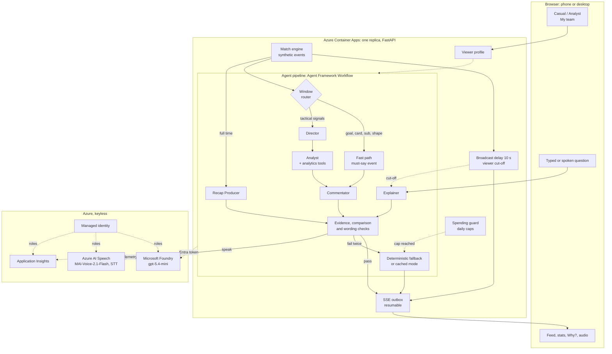

# Architecture

Second Screen Pundit is one container. It replays a synthetic match, has a team of Foundry agents decide what's worth saying and say it, and checks every line against facts computed from the match before the viewer sees or hears it.

## The five challenge stages

| Stage | What does it | Where |
| :-- | :-- | :-- |
| **Ingest** | A seeded generator produces every pass, carry, shot, tackle, interception, foul, card, substitution and formation change for three fictional fixtures, each with a scripted storyline. The replay streams them as live events at the chosen speed. | `engine/generate.py`, `engine/replay.py`, `engine/storylines.yaml` |
| **Interpret** | Deterministic analytics turn events into facts with IDs: possession, shots, xG, pressing, high turnovers, formations, windows compared over time. Every 3 match minutes, tactical signals (a possession swing, an xG surge, a pressing change after a substitution, a red card, a formation change) mark what may be worth a line. | `agents/tools/analytics.py`, `agents/signals.py`, `engine/analytics.yaml` |
| **Explain** | The Director decides whether a window is worth a line; the Analyst writes an insight citing facts; the Commentator says why it matters in one line. The Explainer answers "why" questions and the Recap Producer tells the story at full time. Every output is checked before release. | `agents/pipeline.py`, `agents/prompts.py`, `agents/evidence.py`, `agents/comparisons.py` |
| **Render** | Lines reach the browser over SSE after the broadcast delay, are spoken by Azure AI Speech, and sit beside a pitch mini-map, live stats and key moments. **Why?** on any line opens the facts and events behind it. | `api.py`, `outbox.py`, `agents/speech.py`, `web/` |
| **Personalize** | **Casual** gets the story with at most one number per line, short plain answers and the numbers behind a tap. **Analyst** gets chance quality, shape and stats, longer answers and the evidence open. **My team** frames lines and answers as "your side", marks that team on screen and lifts the crowd for its goals. All from the same facts, through the same checks. | `profile.py`, `agents/prompts.py`, `agents/fallbacks.py`, `web/app.js` |

## The parts

**Browser.** A single page that works from 360px phones to desktop. It holds the replay token in memory, reconnects its stream with `Last-Event-ID`, pauses the match when the tab is hidden, and plays lines, answers and the recap through one audio queue. The crowd bed and whistles are generated in the browser.

**Container Apps.** One FastAPI process on one replica (`minReplicas` 1, `maxReplicas` 1), because replays, outboxes and resume positions live in memory. The image is built remotely in Azure Container Registry by `azd`.

**Match engine and broadcast delay.** Agents see each event as it is published; the viewer's stream releases it 10 seconds later, like a broadcast. A line waits for the release of the event it describes, and questions are answered at the viewer's released position, so nothing reaches the viewer ahead of the match.

**Fast path.** Goals, cards, substitutions, formation changes and big chances skip the Director and Analyst. The server builds the insight from deterministic facts and makes one Commentator call, so the line lands within a few seconds of the event.

**Tactical lane.** Signals at each 3-minute boundary go to the Director (mandatory ones, such as a red card or a formation change, skip it). The Analyst calls read-only analytics tools and returns an insight that cites fact IDs. A newer window makes an unfinished older one stale, and cooldowns keep the lines spaced.

**Director, Analyst, Commentator, Explainer, Recap Producer.** Five Foundry agents built with Microsoft Agent Framework, each with structured output, a token cap, a time budget and `store: False`. The live route is a `WorkflowBuilder` graph that sends a must-say window to the fast-path executor and a periodic one to the tactical executor. Function middleware captures each tool result, so the checks use exactly the facts the agents saw.

**Evidence check.** Every number, score, formation and minute in a line, answer or recap must match a fact from this run's tool results, with the team and metric named in the same sentence. Every cited event must be at or before the run's position. Anything else fails.

**Comparison check.** Words such as "more of the ball", "the better of the chances", "on top" or "under pressure" are attached to the nearest team before them and checked against possession, shots and xG, for the match so far or the current spell.

**Wording checks.** Banned phrases (hype, betting, invented detail), scoring-team phrases on goal lines, a real-name filter, team-name house style, the clock budget, and the profile rules (numbers per line in Casual, answer length, "your side" framing).

**Fallbacks.** A failed output gets one retry with feedback naming the problem. If it fails again, the viewer gets a deterministic line, the verified facts as an answer, or a deterministic recap, each of which passes the same checks. A model or speech failure never stops the match.

**Spending guard.** Daily caps on model calls and TTS characters. When the model cap is reached, new viewers get cached mode: pre-written, pre-checked lines and answers with no model calls. `NARRATIVE_MODE=off` is the kill switch.

**Microsoft Foundry.** One `gpt-5.4-mini` deployment (Data Zone Standard, Australia East) serves all five agents through `FoundryChatClient`, with low reasoning effort and one reused client per deployment.

**Azure AI Speech.** Text-to-speech with the MAI voice `en-GB-Harry:MAI-Voice-2.1-Flash` in Sweden Central, a style per moment (joyful for goals, surprised for late drama, narrator for tactics), and `en-GB-RyanNeural` as an automatic fallback. Push-to-talk questions are transcribed on the server. The browser never gets a Speech token.

**Managed identity.** One user-assigned identity holds four roles, assigned by GUID and scoped to each resource: Foundry User, Cognitive Services Speech User, AcrPull and Monitoring Metrics Publisher. Local auth is disabled on Foundry, Speech and Application Insights, the registry's admin user is off, and the container app has no secrets.

**Application Insights.** Agent Framework emits `invoke_agent`, `chat` and `execute_tool` spans with token counts. The app wraps each live window, question and recap in a `pundit.turn` span with the route, evidence result and viewer profile, and adds spans for speech. No question or answer text goes into telemetry.
